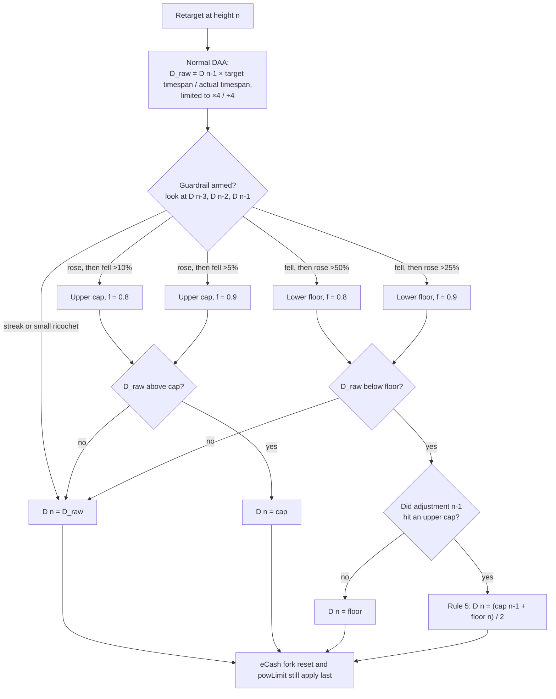
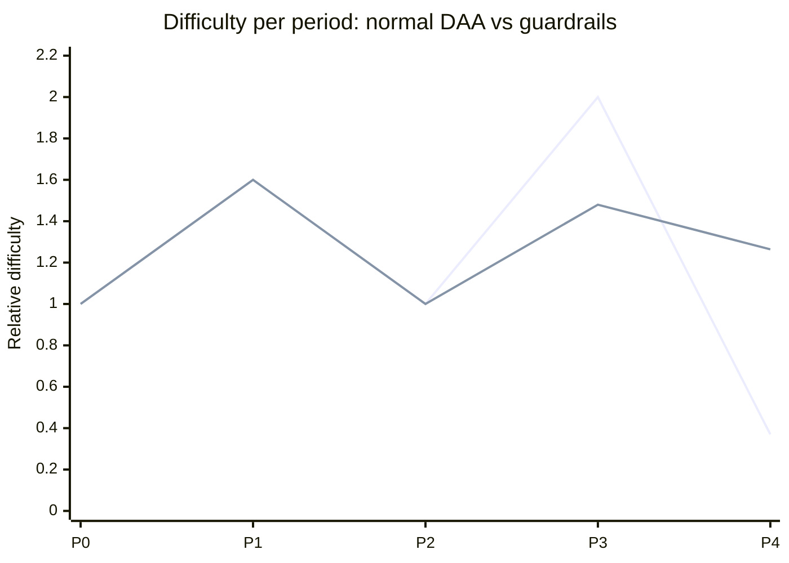

# DAA ricochet guardrails

eCash keeps Bitcoin's difficulty adjustment algorithm (DAA): every 2016 blocks
the target is rescaled by how long the period actually took, limited to a
factor of 4 in either direction. On top of that, eCash adds **ricochet
guardrails**:

> Leave the difficulty untouched while it rises or falls in long streaks. But
> if it starts ricocheting around, clamp it down for just one period.

A ricochet is a direction change: up then down, or down then up. A large enough
ricochet *arms* a guardrail. The guardrail only limits the **following**
adjustment, and only stops the difficulty from bouncing all the way back to the
value the ricochet just came from.

The implementation is in [`src/pow.cpp`](src/pow.cpp) (`GetGuardrail`,
`CalculateNextWorkRequired`) and the tests are in
[`src/test/pow_tests.cpp`](src/test/pow_tests.cpp) (`daa_guardrail_*`).

## The rules

`D(n)` is the difficulty of period `n`. When the retarget at the start of
period `n` is computed, `D(n-1)` is the latest difficulty, `D(n-2)` the one
before it, and `D(n-3)` the one before that.

| Rule | Last move | This move | Guardrail armed for the **next** adjustment |
|------|-----------|-----------|---------------------------------------------|
| 1 | rose | fell by more than 5% | **upper** cap at 90% of the distance back to the "too high" value |
| 2 | rose | fell by more than 10% | **upper** cap at 80% of the distance back to the "too high" value |
| 3 | fell | rose by more than 25% | **lower** floor at 90% of the distance back to the "too low" value |
| 4 | fell | rose by more than 50% | **lower** floor at 80% of the distance back to the "too low" value |
| 5 | | | the upper guardrail was hit, then the lower one: set the difficulty to the **average of the two guardrails** |

Rules 2 and 4 take precedence over rules 1 and 3, so a bigger ricochet arms
a tighter guardrail.

In terms of the three preceding periods (`f` is 0.9 or 0.8):

```
upper cap   (rules 1, 2) = D(n-1) + f · (D(n-2) − D(n-1))    D(n-2) is the "too high" value
lower floor (rules 3, 4) = D(n-1) − f · (D(n-1) − D(n-2))    D(n-2) is the "too low" value
```

Both are the same interpolation `(1−f)·D(n-1) + f·D(n-2)`: the guardrail
sits `f` of the way from where the difficulty is now back to where it
bounced from.

- An **upper** guardrail only stops the next adjustment from *rising* past
  the cap. A smaller rise, or a further fall, goes through untouched.
- A **lower** guardrail only stops the next adjustment from *falling* below
  the floor. A smaller fall, or a further rise, goes through untouched.
- A guardrail is **hit** when the normal DAA result would cross it. The
  result is then clamped to the guardrail.

### Rule 5: both guardrails in a row

If the previous adjustment hit an upper guardrail and this adjustment hits a
lower guardrail, the normal calculation is overridden. The difficulty is set
directly to the arithmetic average of the two guardrails:

```
D(n) = (upper guardrail hit at n-1 + lower guardrail hit at n) / 2
```

This only applies upper then lower, as specified. Lower then upper is clamped
as usual and not averaged (see the `daa_guardrail_lower_then_upper_not_averaged`
test).

## Decision flow



## Worked example: rule 2, then rule 3, then rule 5

This is the `daa_guardrail_both_hit` test. Difficulties are relative to 1.0.



| Period | What happens | Difficulty |
|--------|--------------|------------|
| P0 → P1 | rose | 1.6 |
| P1 → P2 | fell 37.5% after a rise: **rule 2** arms an upper cap at 1.0 + 0.8 · (1.6 − 1.0) = **1.48** | 1.0 |
| P2 → P3 | the normal DAA wants 2.0, which is above the cap. **Upper guardrail hit**: clamp to 1.48. That is a 48% rise after a fall, so **rule 3** arms a lower floor at 1.48 − 0.9 · (1.48 − 1.0) = **1.048** | 1.48 |
| P3 → P4 | the normal DAA wants 0.37, which is below the floor. **Lower guardrail hit** right after an upper one, so **rule 5** applies: (1.48 + 1.048) / 2 | **1.264** |

Without the guardrails the difficulty would swing 1.0 → 2.0 → 0.37. With them
it settles at 1.48 and then 1.264.

## No state to track or rescan

Everything a guardrail needs is already in the block index. No new state is
stored, and nothing has to be replayed on startup or after a reorg.

- **Rules 1–4** need the difficulty of the three preceding periods. Each one
  is read from the `nBits` of that period's first block, using
  `CBlockIndex::GetAncestor()`. That follows the skip-list pointers, so each
  lookup takes a few steps no matter how long the chain is.
  The first block of a period is never a testnet min-difficulty block, so it
  always carries the real target.
- **Rule 5** needs to know whether the *previous* adjustment hit an upper
  guardrail. That is recomputed on the spot: re-derive the guardrail armed
  for adjustment `n-1` (from `D(n-4)`, `D(n-3)`, `D(n-2)`), recompute that
  adjustment's normal DAA result from its period's timestamps, and check
  whether it crossed the cap. Stored `nBits` values are final, so this never
  recurses further back.

In total, a retarget does at most eight extra ancestor lookups. The result depends only
on the headers, like the rest of the DAA, so every node computes the same
value.

## Arithmetic

"X% of the distance" is a linear interpolation in *difficulty*. Difficulty is
inversely proportional to the target, so the guardrails are computed in
**work** units, which are proportional to difficulty:

```
work(target)   = (2^256 − 1 − target) / (target + 1) + 1    same as GetBlockProof()
target(work)   = (2^256 − 1 − work) / work
```

The percentage thresholds are integer comparisons on work, for example "fell
by more than 5%" is `20 · W(n-1) < 19 · W(n-2)`. The guardrail itself is
`((10 − k) · W(n-1) + k · W(n-2)) / 10` with `k` = 9 or 8. Rule 5 averages
the two guardrail work values. With mainnet targets, work stays far below 2^251,
so these small multiplications cannot overflow `arith_uint256`.

## Activation and interaction with existing rules

- `Consensus::Params::DaaGuardrailHeight` sets the activation height. It
  defaults to disabled (`INT_MAX`).
  - **Mainnet:** set to `EcashHeight` (973728). The fork's difficulty reset
    is the first move that can arm a guardrail. A big rise right after the
    reset is exactly the kind of ricochet these rules are meant to damp.
  - **Testnet3, testnet4, signet:** disabled, so their existing histories stay
    valid.
  - **Regtest:** has no retargeting at all (`fPowNoRetargeting`).
- **Only moves made after activation count.** Both moves that arm a guardrail
  must have happened at or after `DaaGuardrailHeight`. Pre-fork Bitcoin
  history can never arm one.
- **eCash fork reset:** the reset at `EcashHeight` still overrides everything.
  An adjustment at `EcashHeight` never counts as "hitting" a guardrail for
  rule 5.
- **`PermittedDifficultyTransition`** (also used during header pre-sync) is
  unchanged. A guardrail always lands between the previous difficulty and the
  normal DAA result, so it stays inside the existing ×4 / ÷4 bounds.
- **This is a consensus change.** `ContextualCheckBlockHeader` requires
  `nBits == GetNextWorkRequired(...)`, so every node must run the same rules
  from `DaaGuardrailHeight` onward.

## Tests

```
build/bin/test_bitcoin --run_test=pow_tests
```

| Test | Covers |
|------|--------|
| `daa_guardrail_streaks_untouched` | streaks, and ricochets below the thresholds, are left alone |
| `daa_guardrail_upper` | rules 1 and 2, plus a rise below the cap or a further fall passing through untouched |
| `daa_guardrail_lower` | rules 3 and 4, plus a fall above the floor or a further rise passing through untouched |
| `daa_guardrail_only_next_adjustment` | a guardrail applies to one adjustment only |
| `daa_guardrail_both_hit` | rule 5, upper then lower (the worked example above) |
| `daa_guardrail_lower_then_upper_not_averaged` | rule 5 does not apply lower then upper |
| `daa_guardrail_activation` | activation-height boundary, and the mainnet setting |

The tests build real block-index chains period by period and compare the
results against expected difficulties worked out independently in floating
point.
